# FitNest Gym – Locker Management System

> **Course:** Backend Development Fundamentals (Modules 1, 2, and 3)  
> **Evaluation:** Academic Group Assignment & Viva Voce  
> **Technologies:** Node.js, Express.js, SQLite (`sqlite`, `sqlite3`)

---

## 1. Project Introduction

**FitNest Gym** is a modern fitness center offering state-of-the-art facilities to its members. To ensure member security and convenience, the gym provides lockers distributed across various floors. This project delivers a robust, simple, and clean RESTful backend service built using **Node.js**, **Express.js**, and an **SQLite** relational database to automate gym member registration, locker tracking, and locker allotment management.

---

## 2. Problem Statement

FitNest Gym previously managed locker allocations manually using paper registers and spreadsheets. This manual workflow led to significant operational challenges:
1. **Forgotten Locker Numbers:** Gym members frequently forgot their assigned locker numbers during workouts.
2. **Double Allotments / Conflicts:** Front-desk staff accidentally assigned the same locker to multiple gym members simultaneously.
3. **Lack of Real-Time Visibility:** Staff could not quickly identify which lockers were `available`, `occupied`, or under `maintenance`.
4. **Inefficient Search:** Searching for lockers across different floors or matching locker IDs was slow and error-prone.
5. **Inconvenient Management:** Releasing lockers after workouts and updating locker status manually caused confusion and delays.

---

## 3. Project Objectives

The primary objectives of the **FitNest Gym – Locker Management System** are:
- **Automate Core Management:** Manage Gym Members, Gym Lockers, and Locker Allotments seamlessly via RESTful APIs.
- **Enforce Concurrency & Integrity:** Prevent two members from being allotted the same locker simultaneously through both database-level uniqueness constraints and controller validation.
- **Maintain Locker Lifecycle:** Automatically mark a locker as `occupied` upon successful allotment and restore it to `available` upon allotment deletion (unless marked for `maintenance`).
- **Implement Custom Smart Search:** Provide case-insensitive, partial-text searching across locker names and floors using SQL `LOWER()` and `LIKE`.
- **Relational Integrity via SQL JOIN:** Provide a comprehensive endpoint (`GET /allotments/details`) combining data across all three tables (`allotments`, `members`, `lockers`).
- **Strict Academic Syllabus Adherence:** Rely purely on syllabus-approved tools—Node.js, Express.js, SQLite, CommonJS syntax (`require`/`module.exports`), and standard HTTP methods/status codes—avoiding complex ORMs or unapproved packages.

---

## 4. Technologies Used

| Technology / Tool | Version / Purpose |
| :--- | :--- |
| **Node.js** | Server-side JavaScript runtime environment (v18+) |
| **Express.js** | Minimal and flexible Node.js web application framework |
| **SQLite3** (`sqlite3`) | Self-contained, serverless, zero-configuration SQL database engine |
| **sqlite** (`sqlite`) | Promise-based SQLite client wrapper for Node.js (`open`, `db.all`, `db.get`, `db.run`, `db.exec`) |
| **Nodemon** | Development tool for automatic server restarting upon file changes |
| **Postman** | API development, documentation, and automated test execution tool |

> **Note on Syllabus Constraints:** No external ORMs (such as Prisma or Sequelize), no non-SQLite databases (such as MongoDB, MySQL, PostgreSQL), and no frontend frameworks (React, Next.js) or TypeScript are used in this project.

---

## 5. Project Folder Structure

The project follows a clean MVC-inspired architecture suited for Node.js and Express:

```text
fitnest-gym/
│
├── config/
│   └── database.js               # SQLite connection initialization, PRAGMA setup, and seed loader
│
├── database/
│   └── schema.sql                # SQL DDL script defining tables, keys, and constraints
│
├── routes/
│   ├── members.js                # Express router for /members endpoints
│   ├── lockers.js                # Express router for /lockers endpoints
│   └── allotments.js             # Express router for /allotments endpoints
│
├── controllers/
│   ├── memberController.js       # Business logic and SQL queries for members
│   ├── lockerController.js       # Business logic, CRUD operations, and Smart Search for lockers
│   └── allotmentController.js    # Logic for allotments, status transitions, and SQL JOIN
│
├── middleware/
│   └── validation.js             # Request body & parameter validation middleware
│
├── screenshots/                  # Evidence screenshots organized by team member
│   ├── member-1-server-and-routes/
│   ├── member-2-database/
│   ├── member-3-rest-endpoints/
│   ├── member-4-validation-and-search/
│   └── member-5-joins-twist-and-documentation/
│
├── tests/
│   ├── test-db.js                # SQLite schema and connectivity verification script
│   ├── test-api.js               # Comprehensive 44-assertion automated API integration test suite
│   └── test-postman.js           # Direct runner executing all postman_collection.json requests
│
├── fitnest.db                    # SQLite relational database file (created automatically on startup)
├── server.js                     # Express application entry point, middleware registration, app.listen()
├── package.json                  # NPM project metadata, dependencies, and execution scripts
├── postman_collection.json       # Exported Postman Collection v2.1.0 with tests
├── .gitignore                    # Git ignore file for node_modules and logs
└── README.md                     # Complete project documentation and viva preparation guide
```

---

## 6. Database Table Descriptions

The SQLite database (`fitnest.db`) consists of **exactly three related tables** with foreign key constraints enabled via `PRAGMA foreign_keys = ON;`.

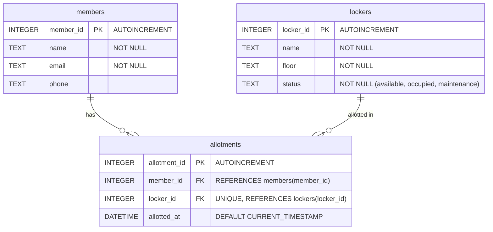

### Table 1: `members`
Stores registered gym members.
* `member_id`: `INTEGER PRIMARY KEY AUTOINCREMENT` — Unique identifier for each member.
* `name`: `TEXT NOT NULL` — Full name of the member.
* `email`: `TEXT NOT NULL` — Contact email address.
* `phone`: `TEXT` — Optional contact phone number.

### Table 2: `lockers`
Stores physical locker units within the gym facility.
* `locker_id`: `INTEGER PRIMARY KEY AUTOINCREMENT` — Unique identifier for each locker.
* `name`: `TEXT NOT NULL` — Display label (e.g., `"Locker A1"`).
* `floor`: `TEXT NOT NULL` — Floor location (e.g., `"Ground Floor"`, `"First Floor"`).
* `status`: `TEXT NOT NULL CHECK(status IN ('available', 'occupied', 'maintenance'))` — Current locker condition.

### Table 3: `allotments`
Stores active assignments connecting members to lockers.
* `allotment_id`: `INTEGER PRIMARY KEY AUTOINCREMENT` — Unique allotment record ID.
* `member_id`: `INTEGER NOT NULL` — Foreign key referencing `members(member_id)` with `ON DELETE RESTRICT`.
* `locker_id`: `INTEGER NOT NULL UNIQUE` — Foreign key referencing `lockers(locker_id)` with `ON DELETE RESTRICT`. The `UNIQUE` constraint ensures a locker cannot have more than one active allotment.
* `allotted_at`: `DATETIME DEFAULT CURRENT_TIMESTAMP` — Timestamp when allotment was established.

---

## 7. API Endpoint Documentation

Base URL: `http://localhost:3000`

### 7.1 Members API

| Method | Endpoint | Description | Expected Status Codes |
| :--- | :--- | :--- | :--- |
| `GET` | `/members` | Retrieve all registered members | `200 OK`, `500 Internal Error` |
| `GET` | `/members/:id` | Retrieve a single member by ID | `200 OK`, `400 Bad ID`, `404 Not Found` |
| `POST` | `/members` | Register a new member | `201 Created`, `400 Bad Request` |
| `DELETE` | `/members/:id` | Delete member (blocked if active allotment exists) | `200 OK`, `404 Not Found`, `409 Conflict` |

#### Example: `POST /members`
**Request Body:**
```json
{
  "name": "Rahul",
  "email": "rahul@example.com",
  "phone": "9876543210"
}
```
**Response (`201 Created`):**
```json
{
  "message": "Member added successfully.",
  "member": {
    "member_id": 1,
    "name": "Rahul",
    "email": "rahul@example.com",
    "phone": "9876543210"
  }
}
```

---

### 7.2 Lockers API (Full CRUD & Smart Search)

| Method | Endpoint | Description | Expected Status Codes |
| :--- | :--- | :--- | :--- |
| `GET` | `/lockers` | Retrieve all lockers | `200 OK` |
| `GET` | `/lockers?q=word` | Custom Smart Search (name & floor, case-insensitive) | `200 OK` |
| `GET` | `/lockers?floor=name`| Filter lockers by floor | `200 OK` |
| `GET` | `/lockers/:id` | Retrieve a single locker by ID | `200 OK`, `400 Bad ID`, `404 Not Found` |
| `POST` | `/lockers` | Add a new locker | `201 Created`, `400 Bad Request` |
| `PUT` | `/lockers/:id` | Update locker details | `200 OK`, `400 Bad Request`, `404 Not Found`, `409 Conflict` |
| `DELETE` | `/lockers/:id` | Delete locker (blocked if active allotment exists) | `200 OK`, `404 Not Found`, `409 Conflict` |

#### Example: `POST /lockers`
**Request Body:**
```json
{
  "name": "Locker A1",
  "floor": "Ground Floor",
  "status": "available"
}
```
**Response (`201 Created`):**
```json
{
  "message": "Locker created successfully.",
  "locker": {
    "locker_id": 1,
    "name": "Locker A1",
    "floor": "Ground Floor",
    "status": "available"
  }
}
```

#### Example: `PUT /lockers/1`
**Request Body:**
```json
{
  "name": "Locker A1 (Renamed)",
  "floor": "First Floor"
}
```
**Response (`200 OK`):**
```json
{
  "message": "Locker updated successfully.",
  "locker": {
    "locker_id": 1,
    "name": "Locker A1 (Renamed)",
    "floor": "First Floor",
    "status": "available"
  }
}
```

---

### 7.3 Allotments API & SQL JOIN

| Method | Endpoint | Description | Expected Status Codes |
| :--- | :--- | :--- | :--- |
| `GET` | `/allotments` | Retrieve all raw allotment records | `200 OK` |
| `GET` | `/allotments/details` | SQL JOIN combining allotments, members, & lockers | `200 OK` |
| `GET` | `/allotments/:id` | Retrieve a single allotment by ID | `200 OK`, `404 Not Found` |
| `POST` | `/allotments` | Allot an available locker to a member | `201 Created`, `400 Bad Request`, `404 Not Found`, `409 Conflict` |
| `DELETE` | `/allotments/:id` | Delete allotment & mark locker available | `200 OK`, `404 Not Found` |

#### Example: `POST /allotments`
**Request Body:**
```json
{
  "member_id": 1,
  "locker_id": 2
}
```
**Response (`201 Created`):**
```json
{
  "message": "Locker allotted successfully.",
  "allotment": {
    "allotment_id": 1,
    "member_id": 1,
    "locker_id": 2,
    "allotted_at": "2026-11-14 09:30:00"
  }
}
```

#### Example: `GET /allotments/details` (SQL JOIN)
**Response (`200 OK`):**
```json
[
  {
    "allotment_id": 1,
    "member_id": 1,
    "member_name": "Rahul",
    "locker_id": 2,
    "locker_name": "Locker A2",
    "floor": "Ground Floor",
    "allotted_at": "2026-11-14 09:30:00"
  }
]
```

#### SQL JOIN Query Explanation:
```sql
SELECT 
  allotments.allotment_id,
  allotments.member_id,
  members.name AS member_name,
  allotments.locker_id,
  lockers.name AS locker_name,
  lockers.floor,
  allotments.allotted_at
FROM allotments
INNER JOIN members ON allotments.member_id = members.member_id
INNER JOIN lockers ON allotments.locker_id = lockers.locker_id
ORDER BY allotments.allotment_id ASC;
```

---

## 8. HTTP Status Codes Reference

The API uses standardized HTTP status codes to communicate request results:

| Status Code | Meaning | Context in FitNest Gym |
| :--- | :--- | :--- |
| **`200 OK`** | Request succeeded | Successful record retrieval (`GET`), update (`PUT`), search, or deletion (`DELETE`). |
| **`201 Created`** | Resource created | Successful creation of a member, locker, or allotment (`POST`). |
| **`400 Bad Request`** | Client input error | Missing required fields, invalid strings, non-numeric IDs, or attempting to allot a locker under maintenance. |
| **`404 Not Found`** | Resource missing | Querying, updating, or deleting a member, locker, or allotment with a non-existent ID. |
| **`409 Conflict`** | State conflict | Attempting to allot an occupied locker, assigning multiple lockers to a member, updating status of an allotted locker, or deleting a locker/member with an active allotment. |
| **`500 Internal Server Error`** | Server error | Unexpected database or server execution failure. |

---

## 9. Custom Assignment Feature – Smart Search

The **Smart Search** feature allows staff to quickly locate lockers across all floors using the query parameter `q` (`GET /lockers?q=word`).

### Implementation Details:
* **Target Columns:** Searches both `name` and `floor`.
* **Partial Matching:** Matches the search term anywhere within the text using SQL `LIKE '%word%'`.
* **Case-Insensitive:** Converts both column values and search inputs to lowercase using SQLite's `LOWER()` function:
  ```sql
  SELECT * FROM lockers 
  WHERE LOWER(name) LIKE ? OR LOWER(floor) LIKE ?
  ORDER BY locker_id ASC;
  ```
* **Empty Result Handling:** If no lockers match the search criteria:
  - Returns HTTP status **`200 OK`** (strictly **not** `404`).
  - Contains an empty array under the key `"lockers": []`.
  - The message is exactly `"Nothing found"`.

### The Three Required Search Test Cases:

#### Test Case 1: Lowercase Search (`GET /lockers?q=locker`)
* **Request:** `http://localhost:3000/lockers?q=locker`
* **Result:** Returns HTTP `200 OK` and a JSON array of all lockers whose name or floor contains the substring `"locker"` (e.g., `"Locker A1"`, `"Locker A2"`, etc.).

#### Test Case 2: Uppercase Search (`GET /lockers?q=LOCKER`)
* **Request:** `http://localhost:3000/lockers?q=LOCKER`
* **Result:** Returns HTTP `200 OK` and an **identical** set of results as Test Case 1, confirming case-insensitivity.

#### Test Case 3: Search with No Matches (`GET /lockers?q=zzz`)
* **Request:** `http://localhost:3000/lockers?q=zzz`
* **Status Code:** `200 OK`
* **Response Body:**
  ```json
  {
    "lockers": [],
    "message": "Nothing found"
  }
  ```

---

## 10. Business Rules & Integrity Constraints

1. **Foreign Key Enforcement:** SQLite does not enforce foreign keys by default. On every connection, `PRAGMA foreign_keys = ON;` is executed.
2. **Maintenance Protection:** A locker with `status = 'maintenance'` cannot be allotted under any circumstances (`400 Bad Request`).
3. **Double-Allotment Prevention:** An already `occupied` locker or a locker already existing in `allotments` cannot be allotted again (`409 Conflict`).
4. **Automatic Status Transition:**
   - When allotted: Locker status is set to `occupied`.
   - When allotment is deleted: Locker status reverts to `available` (provided it is not in `maintenance`).
5. **Deletion Protection:** A locker or member with an active allotment cannot be deleted without first releasing the allotment (`409 Conflict`).
6. **Status Tamper Protection:** Users cannot manually set an allotted locker to `available` or `maintenance` via `PUT /lockers/:id` without first deleting the active allotment (`409 Conflict`).

---

## 11. Installation & How to Run

### Prerequisites
* [Node.js](https://nodejs.org/) (v18.0.0 or higher recommended)
* NPM (bundled with Node.js)

### Step 1: Install Dependencies
Open a terminal in the project directory and install the required packages:
```bash
npm install express --save
npm install sqlite --save
npm install sqlite3 --save
```
*(Or simply run `npm install`)*

### Step 2: Start the Server
Start the server using standard Node.js:
```bash
node server.js
```
Or start with Nodemon for auto-restart on file edits:
```bash
npx nodemon server.js
# Or if installed globally:
nodemon server.js
```

### Expected Startup Output:
```text
==================================================
FitNest Gym - Locker Management System
Database 'fitnest.db' connected and initialized.
Server is running successfully on http://localhost:3000
==================================================
```

### Step 3: Run Automated Tests
Execute the built-in test suites (integration tests + Postman collection verification):
```bash
npm test
```

---

## 12. How to Test Using Postman

1. Open **Postman**.
2. Click the **Import** button in the top left corner.
3. Select the file **`postman_collection.json`** located in the project root.
4. The collection **`FitNest Gym API Testing`** will appear with 18 organized requests:
   * **1. Members API** (`Get all members`, `Get one member`, `Add a member`)
   * **2. Lockers API** (`Get all lockers`, `Get one locker`, `Add a locker`, `Update a locker`, `Delete a locker`)
   * **3. Custom Feature - Smart Search** (`Search lowercase`, `Search uppercase`, `Search no matches`, `Search by floor`)
   * **4. Allotments API & SQL JOIN** (`Create allotment`, `Test duplicate allotment`, `Get all allotments`, `Get allotment details using JOIN`, `Delete allotment`)
   * **5. Negative & Validation Testing** (`Test invalid locker input`)
5. Click on the collection name and select **Run collection**.
6. All 18 tests will execute in sequence against `http://localhost:3000` and pass automatically!

---

## 13. Group Member Responsibilities

This project was developed collaboratively by our group members, divided into clear modules:

| Member | Role | Assigned Responsibilities |
| :--- | :--- | :--- |
| **Member 1** | **Server & Routes** | Express server setup (`server.js`), port configuration, routing architecture (`routes/members.js`, `routes/lockers.js`, `routes/allotments.js`), error handling, and server startup messaging. |
| **Member 2** | **Database** | Database design (`fitnest.db`), DDL schema script (`database/schema.sql`), SQLite connection management (`config/database.js`), foreign key enforcement (`PRAGMA foreign_keys = ON;`), and initial seed data. |
| **Member 3** | **REST Endpoints** | Member and Locker CRUD controllers (`memberController.js`, `lockerController.js`), HTTP status codes (200, 201, 404, 409, 500), and allotment lifecycle transitions (`allotmentController.js`). |
| **Member 4** | **Validation & Search** | Input validation middleware (`middleware/validation.js`), Custom Smart Search implementation (`q` and `floor` using `LOWER()` & `LIKE`), and empty result handling (`{ "lockers": [], "message": "Nothing found" }`). |
| **Member 5** | **SQL JOIN, Twist Rule, Postman & Documentation** | SQL JOIN endpoint (`GET /allotments/details`), business rules (preventing occupied/maintenance allotment conflicts & deletion blocks), Postman collection (`postman_collection.json`), automated test suites, and project documentation (`README.md`). |

---

## 14. Viva Voce Preparation Guide (Questions & Answers)

### Q1: How does SQLite enforce Foreign Keys in Node.js?
**Answer:** In SQLite, foreign key constraints are disabled by default for backward compatibility. In `config/database.js`, we explicitly execute `PRAGMA foreign_keys = ON;` immediately after calling `open()` on the database. This ensures child records in `allotments` respect parent foreign key references in `members` and `lockers`.

### Q2: How does the Smart Search achieve case-insensitivity?
**Answer:** The controller uses SQLite's built-in `LOWER()` function on both `name` and `floor` columns and compares them against `searchTerm.toLowerCase()` using the SQL `LIKE` operator (`LOWER(name) LIKE ? OR LOWER(floor) LIKE ?` with `%searchTerm%`).

### Q3: Why is `GET /allotments/details` defined before `GET /allotments/:id`?
**Answer:** Express evaluates routes sequentially in the order they are registered. If `/allotments/:id` were defined first, Express would capture the string `"details"` as the `:id` parameter and route it to `getAllotmentById` instead of `getAllotmentDetails`. Defining `/details` first prevents route collision.

### Q4: How is duplicate allotment prevented at both database and application levels?
**Answer:** 
1. **Database Level:** The `locker_id` column in the `allotments` table is declared as `INTEGER NOT NULL UNIQUE`. Any duplicate insert will trigger a unique constraint violation.
2. **Application Level:** In `createAllotment`, the controller verifies whether the locker's status is `'occupied'`, whether it exists in `allotments`, and whether the member already holds an active allotment, returning a meaningful `409 Conflict` before attempting database insertion.

---

# Screenshots & Project Evidence

> [!NOTE]
> **Instructions for Team Members:**  
> The screenshot evidence below is organized by each group member's specific responsibilities. Each member must save their screenshots with the exact filenames specified below inside their dedicated folder in `screenshots/`.  
> Once a screenshot is placed in its folder, the image placeholder will automatically render the image on GitHub.

---

## Member 1 – Server & Routes
**Folder:** `screenshots/member-1-server-and-routes/`

### 1. Server Running Successfully
Terminal output demonstrating the Express server starting up, connecting to `fitnest.db`, and listening on port 3000.


### 2. Root Endpoint
API response for `GET /` showing project metadata, status, and navigation endpoints.
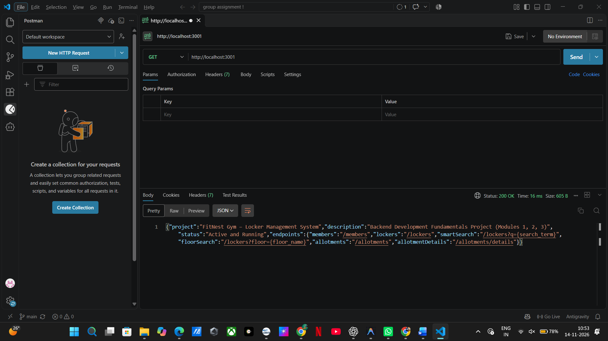

### 3. Members Route Response
API response for `GET /members` returning registered gym members.
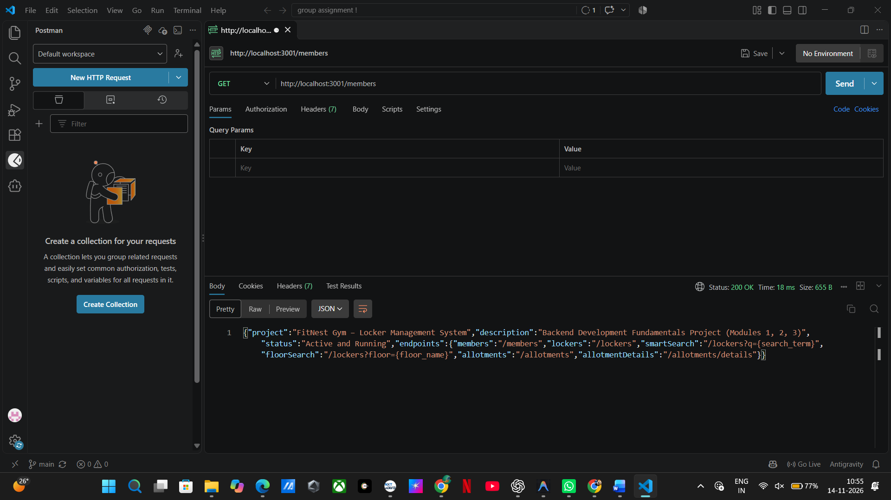

### 4. Lockers Route Response
API response for `GET /lockers` returning all lockers across all floors.
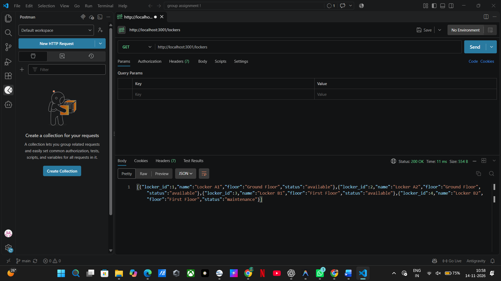

### 5. Allotments Route Response
API response for `GET /allotments` returning the list of active locker allotments.
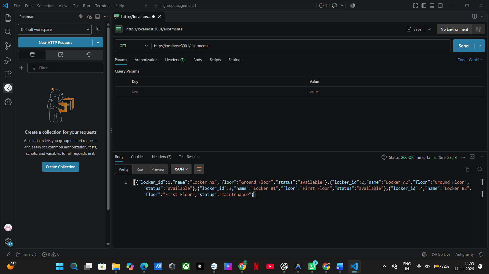

---

## Member 2 – Database
**Folder:** `screenshots/member-2-database/`

### 1. Database Connection
Console and log output verifying successful SQLite database connection and initialization of `fitnest.db`.
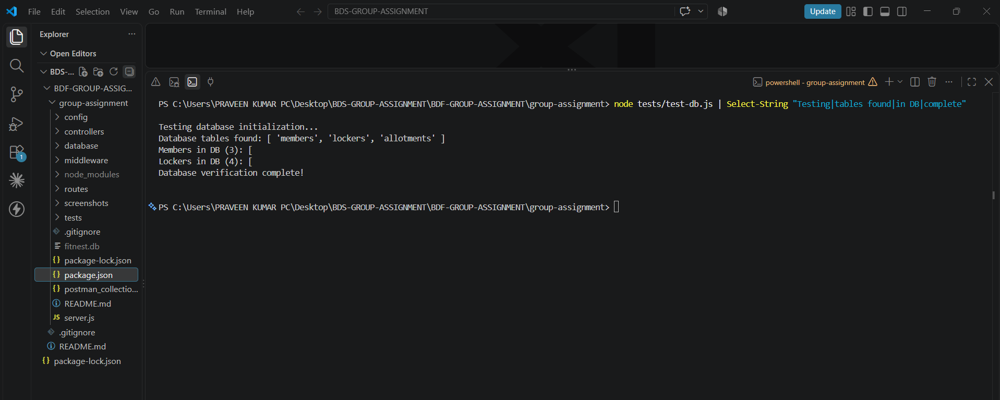

### 2. Database Tables
Database inspection displaying the three required tables: `members`, `lockers`, and `allotments`.
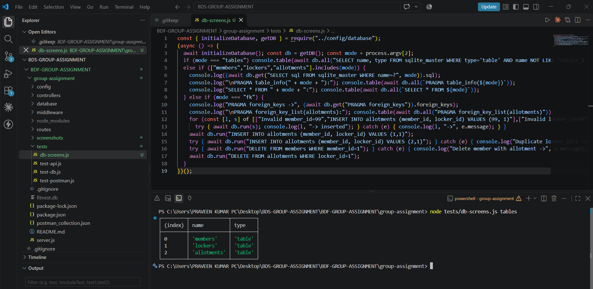

### 3. Members Table Structure & Records
Table schema definition and initial records for the `members` table.
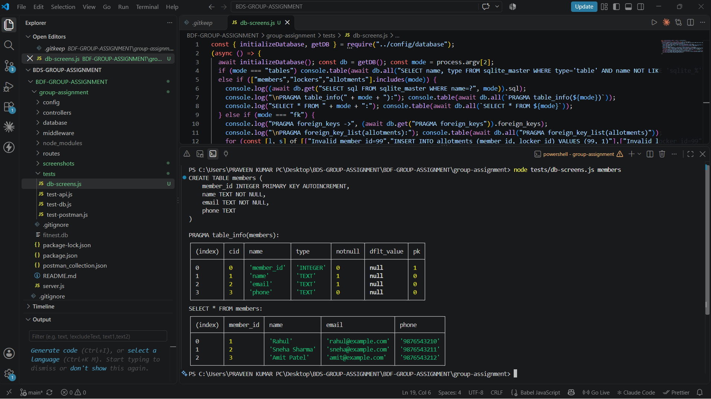

### 4. Lockers Table Structure & Records
Table schema definition and initial records for the `lockers` table with status constraints (`available`, `occupied`, `maintenance`).
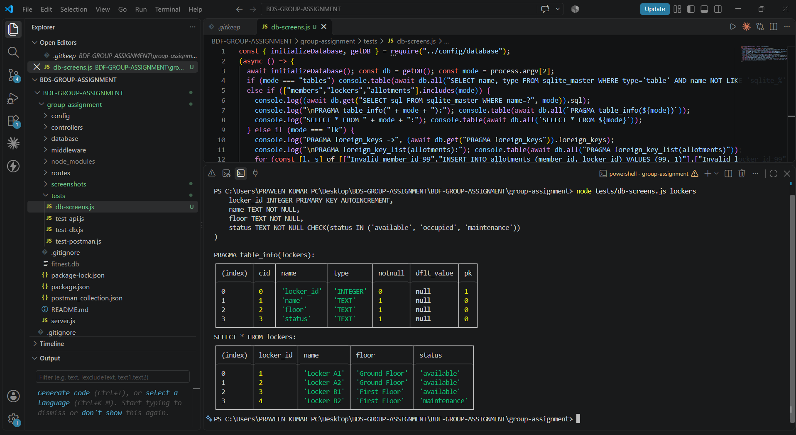

### 5. Allotments Table Structure & Records
Table schema definition and records for the `allotments` table featuring foreign keys and the `UNIQUE` locker constraint.
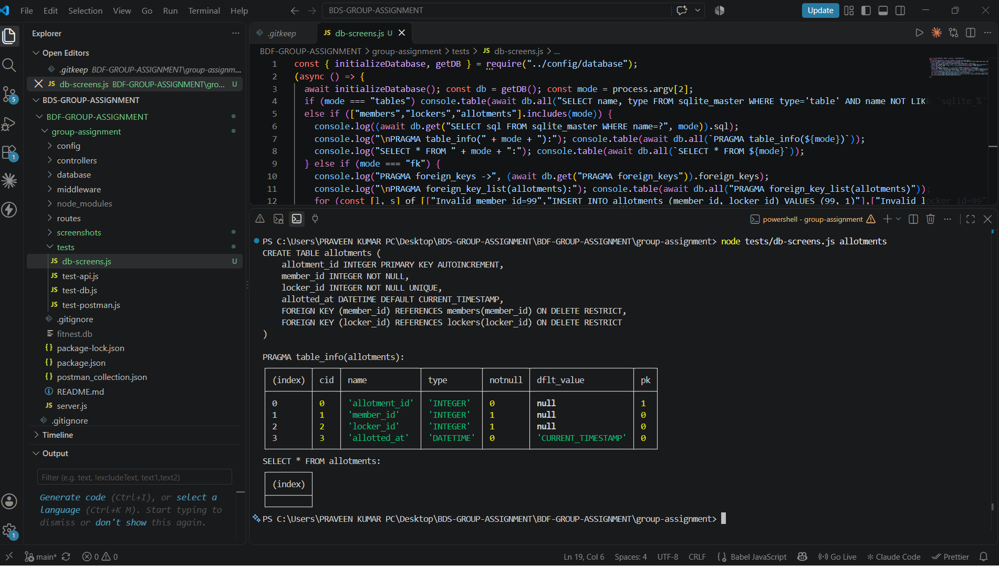

### 6. Foreign-Key Constraints Configuration
Verification of active foreign-key enforcement in SQLite (`PRAGMA foreign_keys = ON;`).
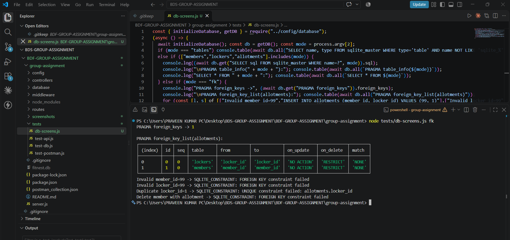

---

## Member 3 – REST Endpoints
**Folder:** `screenshots/member-3-rest-endpoints/`

### 1. Get All Members
`GET /members` retrieving all gym members with HTTP 200 OK.


### 2. Get Single Member
`GET /members/:id` retrieving a single member record by ID with HTTP 200 OK.


### 3. Create Member
`POST /members` creating a new member with valid payload returning HTTP 201 Created.


### 4. Delete Member
`DELETE /members/:id` deleting an unallotted member returning HTTP 200 OK.


### 5. Get All Lockers
`GET /lockers` retrieving all gym lockers with HTTP 200 OK.


### 6. Create Locker
`POST /lockers` creating a new gym locker returning HTTP 201 Created.


### 7. Update Locker
`PUT /lockers/:id` updating locker details (name/floor) returning HTTP 200 OK.


### 8. Delete Locker
`DELETE /lockers/:id` deleting a locker that has no active allotment returning HTTP 200 OK.


### 9. Get All Allotments
`GET /allotments` retrieving all active allotment records with HTTP 200 OK.


### 10. Create Allotment
`POST /allotments` creating an allotment for an available locker returning HTTP 201 Created.


### 11. Delete Allotment
`DELETE /allotments/:id` deleting an allotment and returning HTTP 200 OK with locker status restored to available.


---

## Member 4 – Validation & Smart Search
**Folder:** `screenshots/member-4-validation-and-search/`

### 1. Valid Member Request Validation
Successful request handling when all required input fields are valid.
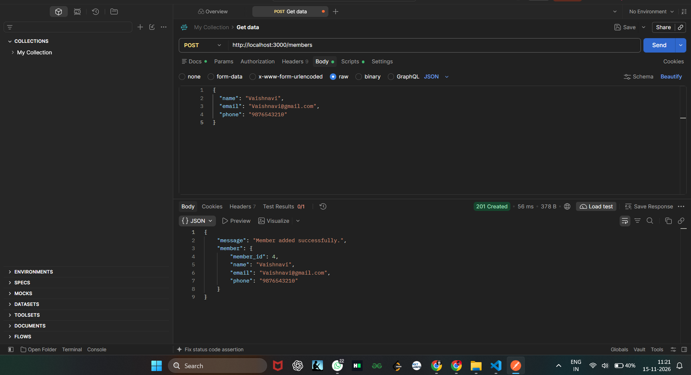

### 2. Invalid Member Request Error Response
Validation rejection with HTTP 400 Bad Request when required member fields (`name`, `email`) are empty or missing.
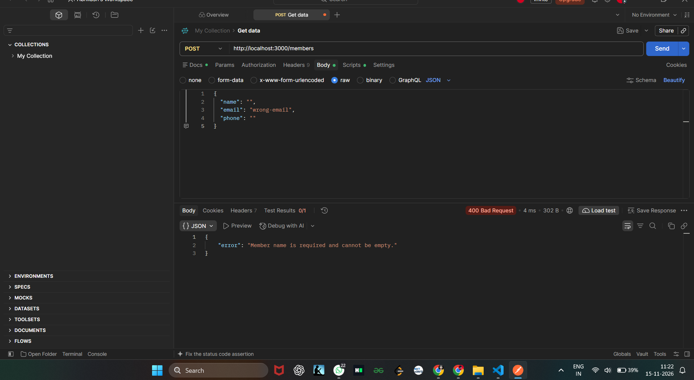

### 3. Invalid ID Route Parameter Handling
Validation rejection with HTTP 400 Bad Request when route parameter `:id` is non-numeric or invalid.
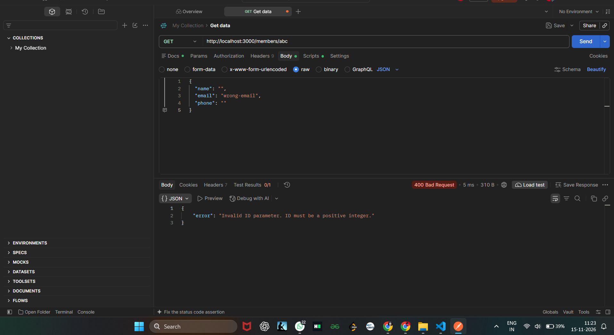

### 4. Smart Search – Lowercase Query
`GET /lockers?q=locker` searching locker names and floors using lowercase query returning matching records.


### 5. Smart Search – Uppercase Query (Case-Insensitive)
`GET /lockers?q=LOCKER` returning identical results to lowercase query, demonstrating case-insensitivity with `LOWER()`.
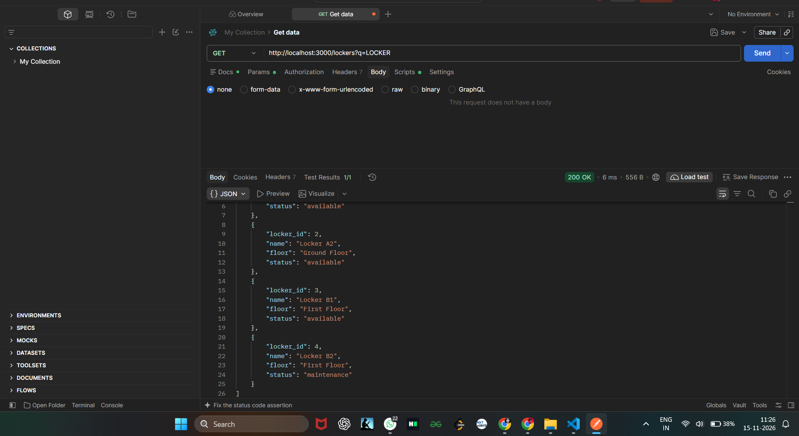

### 6. Smart Search – No Matches Found
`GET /lockers?q=zzz` returning HTTP 200 OK (NOT 404) with an empty array `lockers: []` and message `"Nothing found"`.
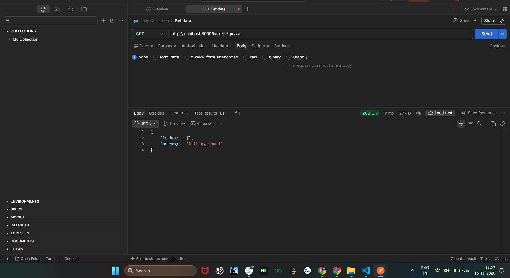

### 7. Floor Search Filter
`GET /lockers?floor=Ground` filtering lockers specifically located on Ground Floor.
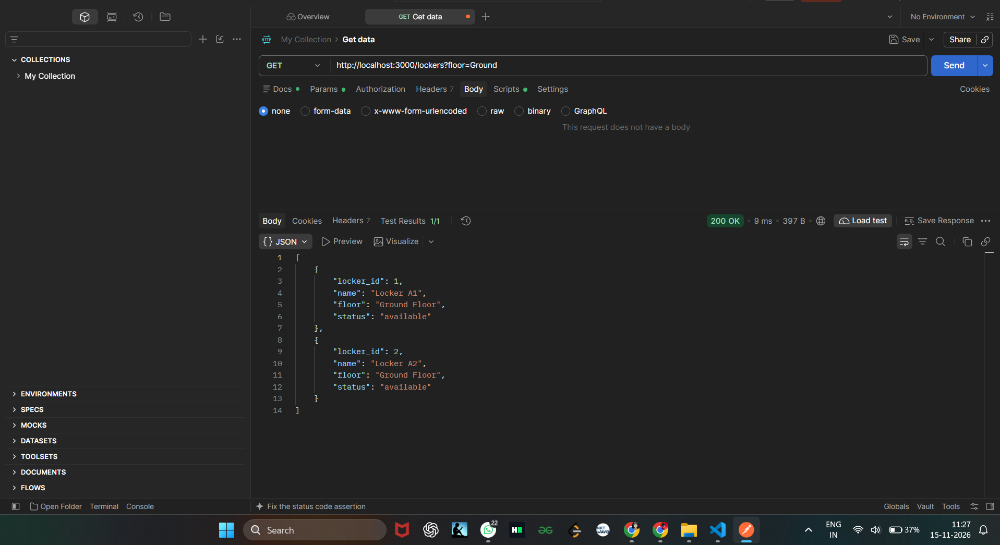

---

## Member 5 – SQL JOIN, Twist Rules & Documentation
**Folder:** `screenshots/member-5-joins-twist-and-documentation/`

### 1. SQL JOIN Allotment Details Endpoint
`GET /allotments/details` demonstrating the SQL INNER JOIN combining allotments, members, and lockers into a unified view.
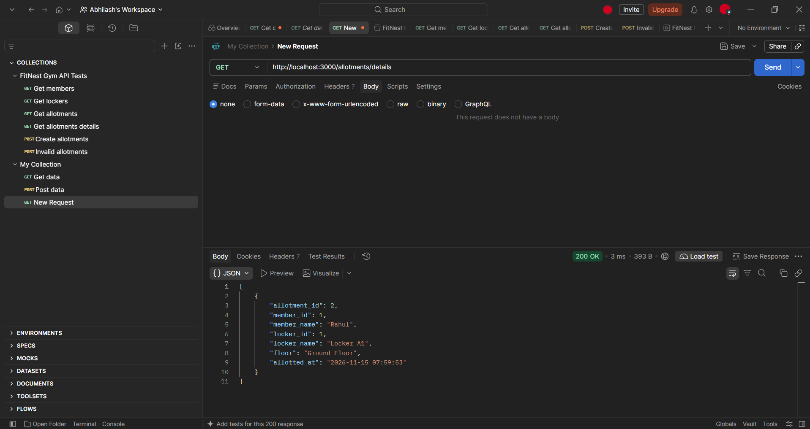

### 2. Successful Locker Allotment
`POST /allotments` assigning an available locker to a member returning HTTP 201 Created and allotment record.
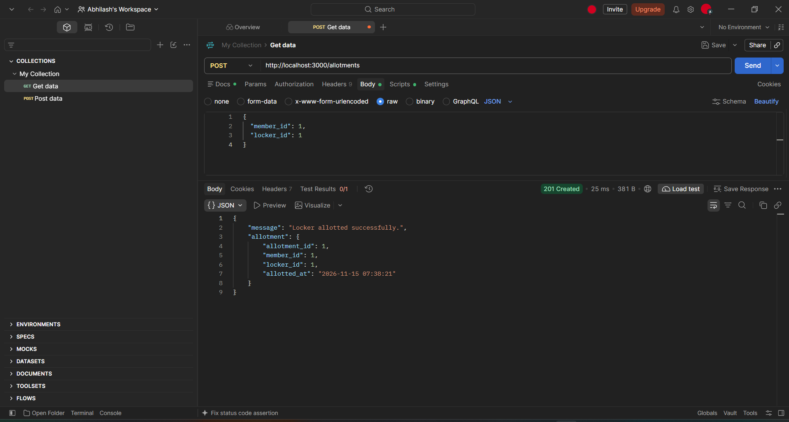

### 3. Occupied Locker Validation (Twist Rule)
`POST /allotments` rejecting allotment of an occupied locker with HTTP 409 Conflict.
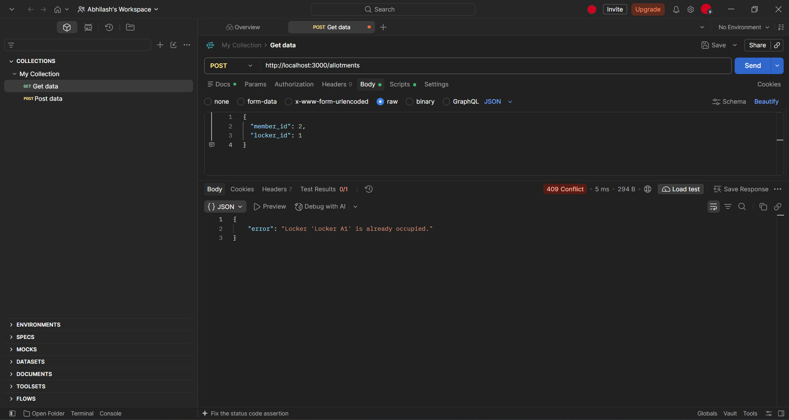

### 4. Duplicate Member Allotment Prevention (Twist Rule)
`POST /allotments` preventing a member who already holds an active locker from getting another, returning HTTP 409 Conflict.
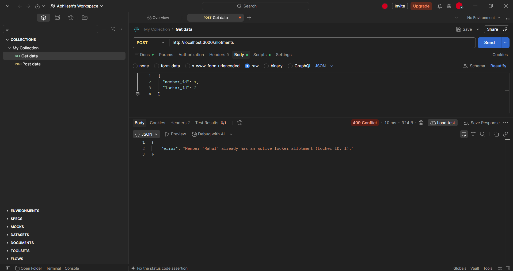

### 5. Maintenance Locker Validation (Twist Rule)
`POST /allotments` rejecting allotment of a locker currently under maintenance with HTTP 400 Bad Request.
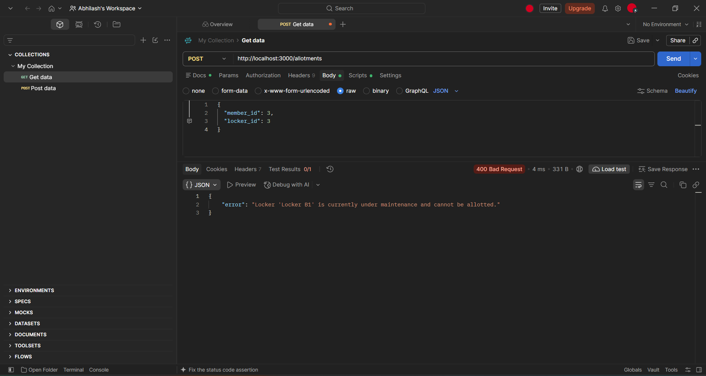

### 6. Locker Status Updated After Allotment
`GET /lockers/:id` demonstrating the locker status transitioning from `'available'` to `'occupied'` upon allotment.
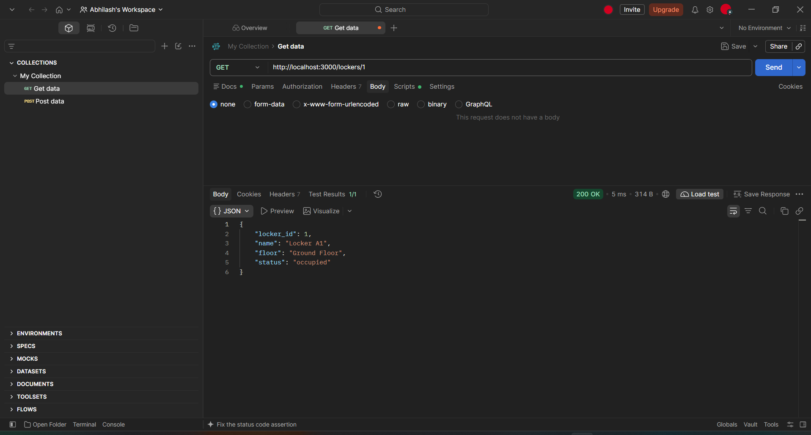

### 7. Locker Status Restored After Deletion
`GET /lockers/:id` demonstrating the locker status automatically resetting to `'available'` upon deleting the allotment.
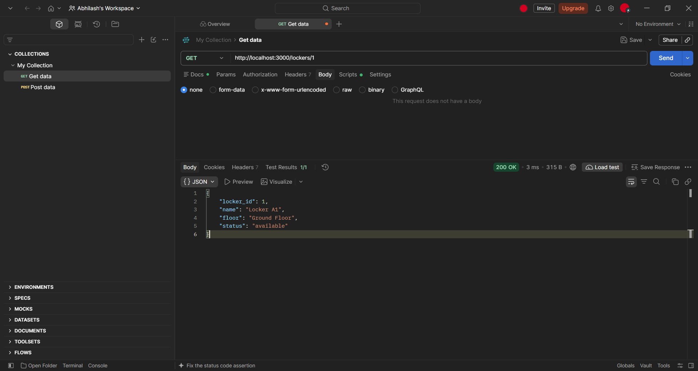

### 8. Postman Test Suite Execution Results
Postman Collection Runner results demonstrating all 18 API test requests executing and passing with green status assertions.
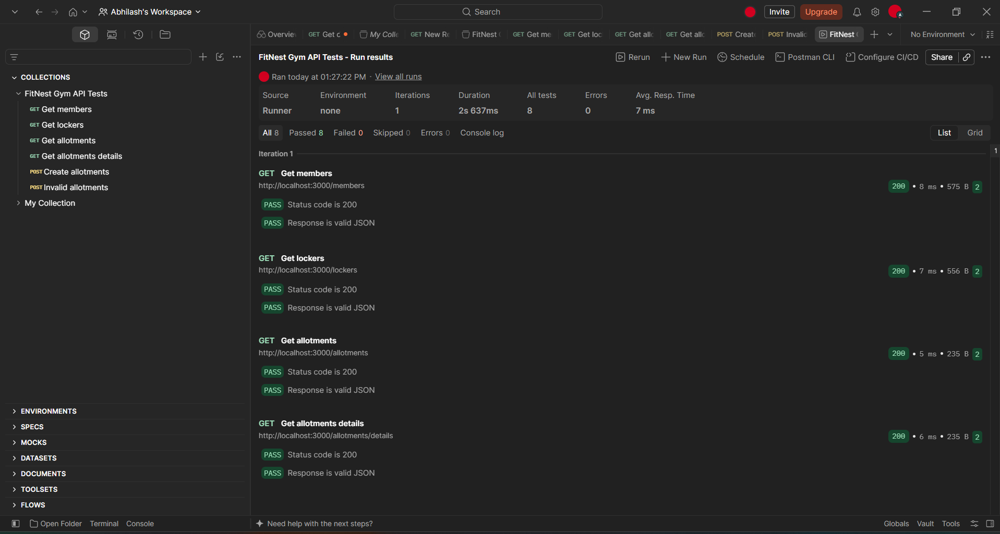

